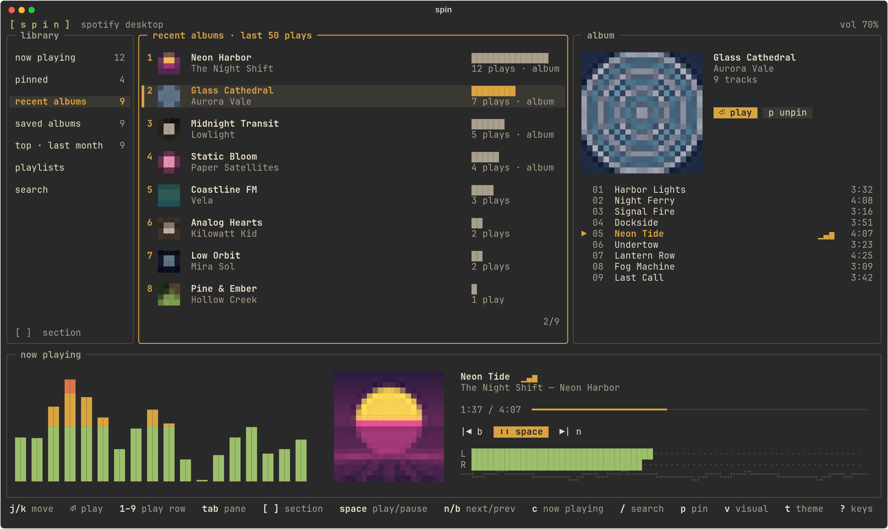
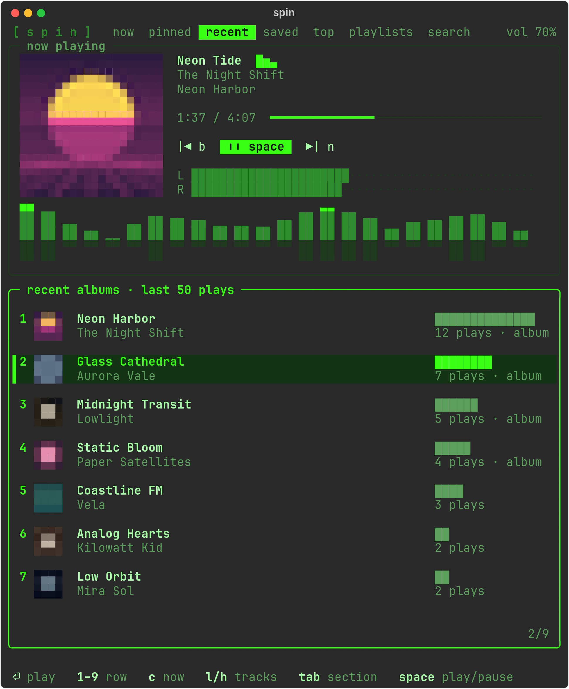
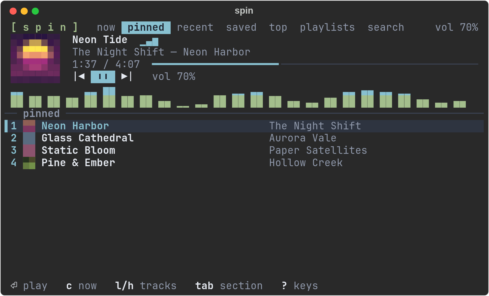
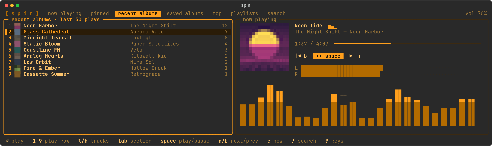
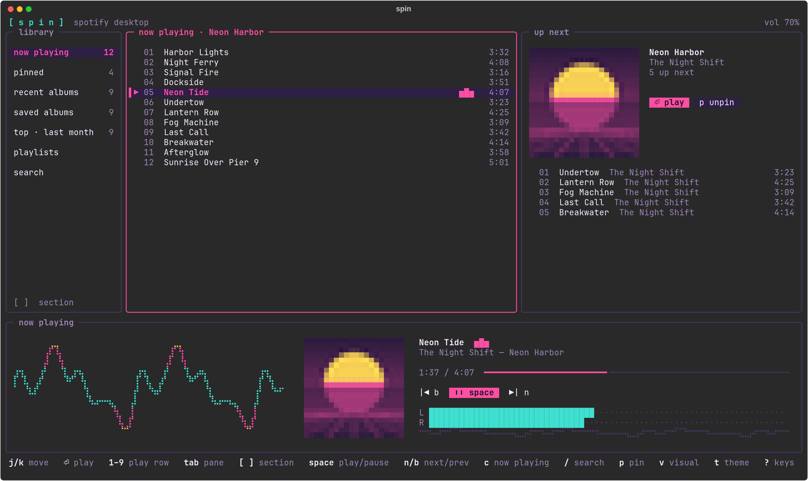

<div align="center">

<h1><code>[ s p i n ]</code></h1>

**An album-first terminal remote for Spotify, with real-audio visualizers.**

Jump back into the records you've been playing, browse your library, and watch the music move,
all without leaving the terminal. spin drives the Spotify desktop app, so playback is the real thing.

[](https://www.python.org)
[](#requirements)
[](#requirements)
[](LICENSE)



<sub>Screenshots use made-up demo albums and generated cover art.</sub>

</div>

## ◆ Features

- **Recent albums, not recent tracks.** Your last 50 plays, grouped by album with play counts, and
  marked when you played it as an album rather than from a playlist. Press `1`–`9` to put one straight back on.
- **Your whole library.** Saved albums, top albums from the last month, playlists, search, and a
  pinned list for the records in heavy rotation.
- **A now playing tab.** The album or playlist that's on, with the current track highlighted and
  your queue up next. `c` jumps to it from anywhere.
- **Visualizers driven by the actual audio.** Spectrum bars from [cava](https://github.com/karlstav/cava),
  plus a triggered oscilloscope, a stereo goniometer and L/R meters fed by raw PipeWire samples.
- **Cover art in the terminal.** Album covers drawn with half-block pixels; no image protocol needed.
- **One layout that fits any pane.** Three panes at full screen, stacked in a half, compact in a
  quarter tile. Built for tiling window managers.
- **Themes.** Follows your [Omarchy](https://omarchy.org) theme, or pick synthwave, phosphor, amber,
  ice or mono.

## ◆ Fits any pane

<table>
<tr>
<td width="50%" valign="top"><br><sub><b>Tall half</b> · phosphor · mirror</sub></td>
<td width="50%" valign="top"><br><sub><b>Quarter tile</b> · ice · bars</sub><br><br><br><sub><b>Wide half</b> · amber · peaks</sub></td>
</tr>
</table>



<sub><b>Now playing tab</b> · synthwave · scope: the playing album with its queue, and the real waveform below.</sub>

## ◆ Visualizers and themes

| Visualizer | What it shows | Source |
|---|---|---|
| `bars` | Frequency spectrum, bass on the left | cava |
| `peaks` | Spectrum with falling peak caps | cava |
| `mirror` | Spectrum with a reflection | cava |
| `scope` | The real waveform, triggered so it holds still | pw-record |
| `vector` | Stereo goniometer: mono is a vertical line, wide stereo spreads out | pw-record |

The L/R meters are true per-channel RMS levels from the same raw audio. Press `v` to cycle
visualizers and `t` to cycle themes: **omarchy** (your desktop theme, or a warm default elsewhere),
**synthwave**, **phosphor**, **amber**, **ice** and **mono**. Both are remembered.

## ◆ Requirements

- Linux with **PipeWire** (`pw-record` feeds the scope and meters)
- **Python 3.11** or newer
- The **Spotify desktop app**, running, on a **Premium** account. Spotify only allows playback
  control through its API for Premium.
- [`playerctl`](https://github.com/altdesktop/playerctl) for now playing and transport controls
- [`cava`](https://github.com/karlstav/cava), recommended, for the spectrum visualizers. Without it
  they fall back to an animation.
- A terminal with truecolor and a font with box-drawing, block and braille characters (most Nerd
  Fonts and JetBrains Mono)

On Arch: `sudo pacman -S playerctl cava`

## ◆ Install

```sh
pipx install git+https://github.com/conyerbd/spin
```

or from a clone:

```sh
git clone https://github.com/conyerbd/spin && cd spin
python3 -m venv .venv && .venv/bin/pip install .
```

## ◆ Setup

spin talks to Spotify through **your own** developer app, so nobody shares a client ID or a rate
limit. It takes a couple of minutes:

1. Open the [Spotify developer dashboard](https://developer.spotify.com/dashboard) and choose
   **Create app**.
2. Give it any name and description.
3. Add the Redirect URI `http://127.0.0.1:19872/login` exactly.
4. Under "Which API/SDKs", tick **Web API**, then save.
5. Run `spin` and paste the app's **Client ID** when asked. Your browser opens to sign in.

New apps start in Development mode, which only lets accounts listed under the app's **User
Management** sign in. The account that created the app is already fine.

## ◆ Usage

Start the Spotify desktop app first; spin plays through it.

```sh
spin            # asks for your Client ID and signs in on first run
spin login      # sign in again
spin logout     # forget the stored tokens
```

| Key | Action | Key | Action |
|---|---|---|---|
| `j` `k` `↑` `↓` | move | `space` | play / pause |
| `⏎` | play album or track | `n` `b` | next / previous track |
| `1`–`9` | play that row | `+` `-` | volume |
| `l` `h` | open / close tracks (pane focus at full screen) | `a` | add track to queue |
| `tab` | next pane, or next section in smaller layouts | `p` | pin / unpin album |
| `[` `]` | previous / next section | `c` | jump to now playing |
| `/` | search | `v` | next visualizer |
| `r` | refresh this section | `t` | next theme |
| `?` | all keys | `q` | quit |

The screen redraws at 60 fps. Add `"fps": 30` to `~/.config/spin/config.json` to halve the CPU it
uses.

## ◆ Troubleshooting

<details>
<summary><b>"Spotify crashed" notifications while the music keeps playing</b></summary>

<br>

That's Spotify's GPU helper process crashing and restarting, not spin. On Hyprland, Spotify runs
through XWayland by default, but its graphics setup picks Wayland, and Mesa crashes on the
mismatch (a SIGSEGV in `libEGL_mesa` → `wl_proxy_create_wrapper`, visible in `coredumpctl`).

Run Spotify natively on Wayland instead. Create `~/.config/spotify-flags.conf`, which the Arch
`/usr/bin/spotify` launcher reads on every start:

```
--enable-features=UseOzonePlatform
--ozone-platform=wayland
```

Quit Spotify fully and reopen it, then check that `hyprctl clients` shows `xwayland: 0` for its
window. If Spotify misbehaves on Wayland, use `--disable-gpu` in that file instead.

</details>

<details>
<summary><b>Why doesn't spin play the audio itself?</b></summary>

<br>

It's a remote for the desktop app on purpose. In testing, librespot-based players (spotifyd,
cliamp) signed in fine but Spotify refused them the audio decryption keys (`error audio key 0 1`),
so every track failed. The desktop app always works.

</details>

<details>
<summary><b>"Spotify rate limit" messages</b></summary>

<br>

spin caches library data on disk and reads now playing from the desktop app rather than the API,
so it stays well under Spotify's limits. If one is hit anyway, spin keeps showing cached data and
says when to try again.

</details>

## ◆ Files

| Path | Holds |
|---|---|
| `~/.config/spin/config.json` | your Client ID, theme, visualizer, fps |
| `~/.config/spin/auth.json` | Spotify tokens (mode 600) |
| `~/.config/spin/pins.json` | pinned albums |
| `~/.cache/spin/` | API responses and cover art |

## ◆ Development

```sh
python3 -m venv .venv && .venv/bin/pip install -e .
.venv/bin/python docs/screenshots.py   # regenerate the README screenshots from demo data
```

## ◆ Credits

Built with [Textual](https://github.com/Textualize/textual). Spectrum by
[cava](https://github.com/karlstav/cava). Music data and playback via the
[Spotify Web API](https://developer.spotify.com/documentation/web-api). spin is not affiliated
with or endorsed by Spotify.

## ◆ License

[MIT](LICENSE)
